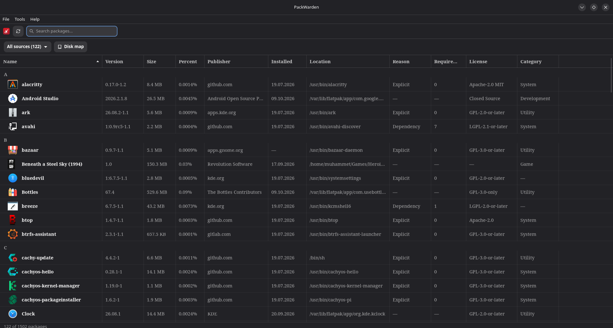
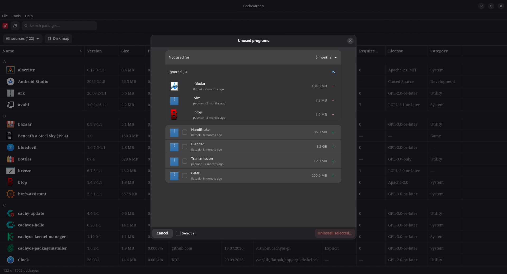
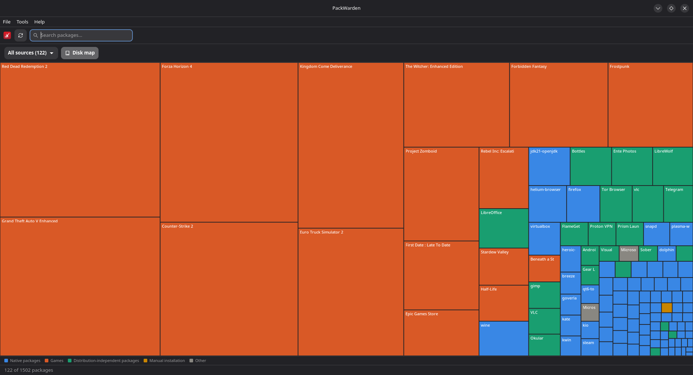
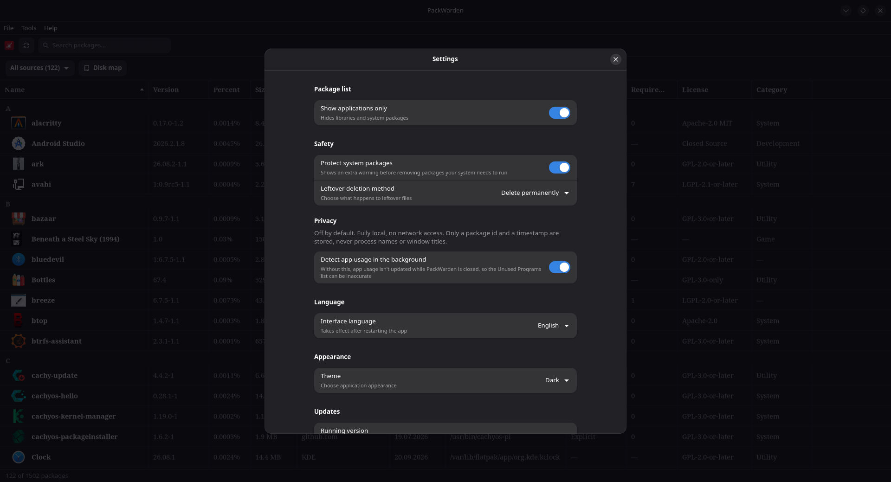

<p align="center">
  
</p>

<h1 align="center">PackWarden</h1>

<p align="center">
  View, manage, and remove the applications installed on your Linux system, from every package source, in one window.
</p>

## Screenshots

| Main window |
|---|
|  |

| Unused programs, with the Ignored list expanded |
|---|
|  |

| Disk map | Settings |
|---|---|
|  |  |

## Features

- **See everything installed, in one place.** PackWarden lists applications
  from pacman, APT, DNF, Zypper, APK, XBPS, Portage, Nix, Flatpak, Snap and
  AppImage, plus games from Steam, Heroic Games Launcher (Epic, GOG, Amazon)
  and Lutris, and Windows apps installed through Wine — all in a single
  table, with real icons, versions, sizes, publishers and install sources.
  Sources are detected automatically; nothing extra to configure.
- **Remove many applications at once.** Select with Ctrl, Shift, drag, or
  tap-and-hold, then confirm once. Before anything is deleted, PackWarden
  shows the leftover settings, caches and data each app left behind, with
  their sizes, so you can tick exactly what to clean up — and it saves a
  backup first, and warns you before touching critical system packages.
- **Find what you don't use anymore.** The Unused programs view flags apps
  you haven't opened in 3 months, 6 months, a year, or a custom period.
  Turning on optional background usage detection makes this more accurate
  by tracking when apps are actually launched, not just installed. Any app
  can be ignored so it stops showing up, and ignored apps stay listed in a
  separate section so you can bring them back at any time.
- **Launch, inspect or remove Wine apps** the same way as any native
  package, and manage games from Steam, Heroic and Lutris right alongside
  the rest of your software.
- **Shape the table to how you work.** Show or hide columns, reorder them,
  and filter the list by name to find an app quickly.
- **Disk map:** a treemap of every installed application, sized by disk
  usage and colored by source, to spot what's eating space at a glance.
- **Stay in control.** In-app toast notifications confirm what happened
  after every action, automatic update checks let you know when a new
  version is out (optional), and the app speaks English and Turkish.

## Designed for Everyday Linux Use

- **One place for everything you've installed.** No more checking your
  package manager, then Flatpak, then your games launcher separately —
  PackWarden brings them all into a single list.
- **Clearer removal.** You see what a removal actually touches — leftover
  files, their sizes, related data — before you confirm it, instead of
  guessing afterward.
- **You decide what stays.** Unused-program detection is a suggestion, not
  an automatic cleanup: ignore what you want to keep, and nothing is ever
  removed without your confirmation.

## Installation

This command installs the application (works with either curl or wget,
whichever is available):

```sh
sh -c 'command -v curl >/dev/null 2>&1 && curl -fsSL https://raw.githubusercontent.com/MuhammetHub111/packwarden/main/install.sh | sh || wget -qO- https://raw.githubusercontent.com/MuhammetHub111/packwarden/main/install.sh | sh'
```

After the installation, open your application menu and search for
PackWarden.

This command removes the application:

```sh
sh ~/.local/share/packwarden/install.sh remove
```

## License

PackWarden is licensed under the [GNU General Public License v3.0 or later](LICENSE) (GPL-3.0-or-later).
